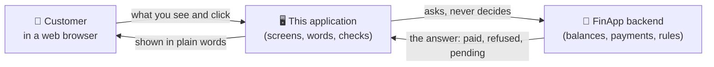
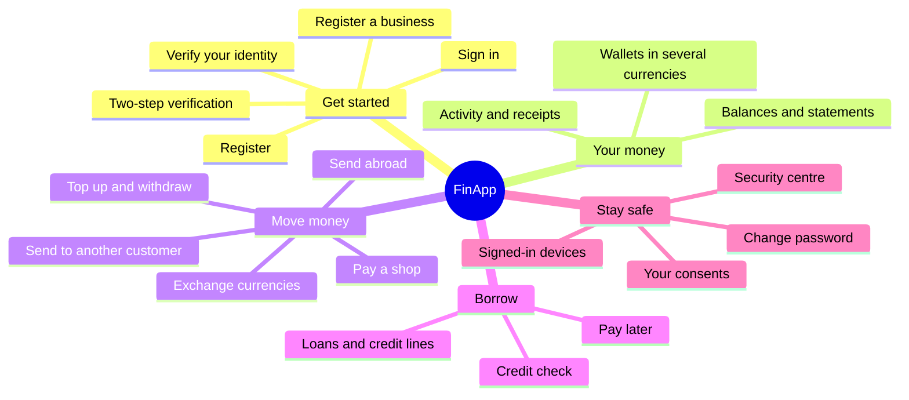
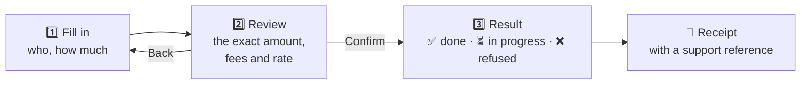
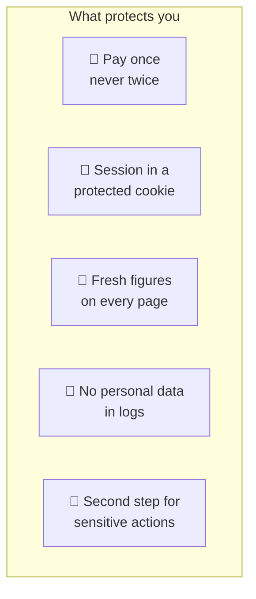

# FinApp Customer Application

The website FinApp customers use to open an account, verify who they are, hold money in several currencies, move it,
and borrow. It is the front end only: every balance, payment and decision comes from the FinApp backend (`finapp`).

- [1. For technical readers: installation](#1-for-technical-readers-installation)
- [2. For everyone: what it is, why, and how to use it](#2-for-everyone-what-it-is-why-and-how-to-use-it)

---

## 1. For technical readers: installation

### 1.1 What you need

| Tool | Version | Why |
|---|---|---|
| Git | any recent | to get the code |
| Node.js | **22.x, at least 22.12** (the project pins 22.14.0 in `.node-version`) | builds and runs the application. Node 23+ is refused (`engine-strict`) |
| npm | 10.9.2 or later (comes with Node 22.14); the lockfile was written by 11.4.2 | installs the exact pinned packages |
| The `finapp` backend | running locally on port 8080 | the application has no data of its own |
| A Chromium browser (Edge or Chrome) | optional | only for the browser checks |

A Node version manager is the easiest way to get exactly Node 22.14.0 next to whatever else you have. The steps below
use **fnm**, which works the same on every operating system and reads `.node-version` by itself.

### 1.2 Windows

Use either **PowerShell** or **Command Prompt (cmd)**. Steps 1-2 are the same in both. Open a new window after each
install so the new commands are found.

**Step 1 - install Git and fnm**

```powershell
winget install --id Git.Git -e
winget install --id Schniz.fnm -e
```

**Step 2 - make fnm active in your shell**

PowerShell, once (adds it to your profile):

```powershell
if (-not (Test-Path $PROFILE)) { New-Item -ItemType File -Path $PROFILE -Force }
Add-Content $PROFILE 'fnm env --use-on-cd --shell powershell | Out-String | Invoke-Expression'
. $PROFILE
```

cmd, in each new window (or put it in a startup script):

```bat
FOR /f "tokens=*" %i IN ('fnm env --use-on-cd --shell cmd') DO CALL %i
```

**Step 3 - get the code and the right Node**

PowerShell:

```powershell
git clone https://github.com/genadigeno/finapp-front.git finapp-front-end
cd finapp-front-end
fnm install
fnm use
node --version
```

cmd:

```bat
git clone https://github.com/genadigeno/finapp-front.git finapp-front-end
cd finapp-front-end
fnm install
fnm use
node --version
```

`node --version` must print `v22.14.0`.

**Step 4 - install the packages** (same in both shells)

```bat
npm ci
```

`npm ci` installs exactly what `package-lock.json` lists. Do not use `npm install`: it can change the lockfile.

**Step 5 - start the backend**, then the application

Start `finapp` as its own README describes (§1.6: `docker compose up -d --wait`, the migrations, then
`gradlew :app:bootRun`), and let it accept this page's address for the session cookie:

PowerShell (in the window that starts finapp):

```powershell
$env:FINAPP_SESSION_COOKIE_ALLOWED_ORIGINS = "http://localhost:5180"
```

cmd:

```bat
set "FINAPP_SESSION_COOKIE_ALLOWED_ORIGINS=http://localhost:5180"
```

Then, in this project:

```bat
npm run dev
```

Open <http://localhost:5180>. Calls to `/v1` go to finapp at `http://localhost:8080`. If finapp is somewhere else:

PowerShell:

```powershell
$env:FINAPP_BACKEND_URL = "http://localhost:9090"
npm run dev
```

cmd:

```bat
set "FINAPP_BACKEND_URL=http://localhost:9090"
npm run dev
```

**Step 6 - check everything** (optional, but required before a commit)

```bat
npm run verify
```

Browser checks with the Edge already on your machine. PowerShell:

```powershell
$env:PW_CHANNEL = "msedge"
npm run test:catalogue
```

cmd:

```bat
set "PW_CHANNEL=msedge"
npm run test:catalogue
```

> In cmd, write `set "NAME=value"` with the quotes. `set NAME=value && ...` keeps a trailing space in the value.

### 1.3 macOS

**Step 1 - install Git and fnm** (with [Homebrew](https://brew.sh))

```bash
brew install git fnm
```

**Step 2 - make fnm active** (zsh is the macOS default; use `~/.bashrc` for bash)

```bash
echo 'eval "$(fnm env --use-on-cd --shell zsh)"' >> ~/.zshrc
source ~/.zshrc
```

**Step 3 - get the code and the right Node**

```bash
git clone https://github.com/genadigeno/finapp-front.git finapp-front-end
```

```bash
cd finapp-front-end
```

```bash
fnm install && fnm use && node --version
```

**Step 4 - install the packages**

```bash
npm ci
```

**Step 5 - start finapp** (its README §1.6) with this page's address allowed, then the application

```bash
export FINAPP_SESSION_COOKIE_ALLOWED_ORIGINS=http://localhost:5180
```

```bash
npm run dev
```

Open <http://localhost:5180>. Another backend address: `FINAPP_BACKEND_URL=http://localhost:9090 npm run dev`.

**Step 6 - check everything**

```bash
npm run verify
```

```bash
PW_CHANNEL=chrome npm run test:catalogue
```

(or install Playwright's own browser once with `npx playwright install chromium` and drop `PW_CHANNEL`).

### 1.4 Linux

**Step 1 - install Git, curl and unzip**

Debian / Ubuntu:

```bash
sudo apt update && sudo apt install -y git curl unzip
```

Fedora / RHEL:

```bash
sudo dnf install -y git curl unzip
```

**Step 2 - install fnm and make it active**

```bash
curl -fsSL https://fnm.vercel.app/install | bash
```

```bash
source ~/.bashrc
```

(The installer adds fnm to `~/.bashrc`; for zsh, add `eval "$(fnm env --use-on-cd --shell zsh)"` to `~/.zshrc`.)

**Steps 3-5** are the same as macOS: clone, `fnm install && fnm use`, `npm ci`, start finapp with
`FINAPP_SESSION_COOKIE_ALLOWED_ORIGINS=http://localhost:5180`, then `npm run dev`.

**Step 6 - check everything.** Playwright's browser needs system libraries on Linux; install both at once:

```bash
npx playwright install --with-deps chromium
```

```bash
npm run verify && npm run test:catalogue
```

### 1.5 Commands

| Command | What it does |
|---|---|
| `npm ci` | Install exactly the lockfile |
| `npm run dev` | Development server on http://localhost:5180, proxying `/v1` to finapp |
| `npm run verify` | Every gate: pins, licences, contract, typecheck, lint, format, tests, build, bundle size |
| `npm test` | Unit and component tests (Vitest) |
| `npm run test:catalogue` | Accessibility, security-policy and performance checks in a real browser (Playwright) |
| `npm run build` then `npm run preview` | The production build, served on http://localhost:4180 with the real security headers |
| `npm run check:reproducible` | Builds twice and requires identical output |
| `npm run contract:pull -- ../finapp <commit>` then `npm run contract:generate` | Re-pin finapp's API contract and regenerate the types |
| `npm run theme:generate` | Regenerate the theme stylesheet after a theme change |
| `npm run sbom` | List of shipped dependencies (CycloneDX) |

### 1.6 Settings

| Name | Where | Values | Notes |
|---|---|---|---|
| `FINAPP_BACKEND_URL` | development server | URL, default `http://localhost:8080` | never in a built image |
| `VITE_SESSION_CARRIER` | build argument (`Dockerfile`) | `memory` (default for builds), `cookie` | `npm run dev` uses `cookie`. `cookie` needs finapp to allow the page's address, or nobody can sign in |
| `PW_CHANNEL` | browser checks | `msedge`, `chrome` | use an installed browser instead of Playwright's own |

Container image: `docker build -t finapp-customer-web .` builds a static nginx image on port 8080 (no secrets inside).

### 1.7 Troubleshooting

| You see | Do this |
|---|---|
| `EBADENGINE` / "Unsupported engine" | You are not on Node 22. Run `fnm use` in the project folder |
| Port 5180 already in use | Another dev server is running; stop it (the port is fixed on purpose) |
| Every page says the service is unavailable | finapp is not running on `FINAPP_BACKEND_URL` |
| Sign-in answers "That request was not accepted" | finapp does not allow `http://localhost:5180`; set `FINAPP_SESSION_COOKIE_ALLOWED_ORIGINS` and restart finapp |
| Browser checks fail on timing only | The performance budgets are strict; rerun on an idle machine |

### 1.8 Where things are

```
src/app/            start-up, routing, sign-in guard, the shell
src/modules/        one folder per area: accounts, move-money, fx-crossborder, credit, security, ...
src/platform/       API client and error handling, session, data cache, translations
src/design-system/  theme, money and date formatting, shared components
src/generated/      types generated from finapp's contract (never edited by hand)
contract/           finapp's API contract, pinned by commit
config/             security headers and nginx
e2e/, tests/        browser checks and tests
docs/               plan, decisions, ADRs, runbook, threat model, what finapp still has to build
```

Start with [`docs/CUSTOMER_APP_BLUEPRINT.md`](docs/CUSTOMER_APP_BLUEPRINT.md) (architecture),
[`docs/RUNBOOK.md`](docs/RUNBOOK.md) (operating it) and
[`docs/FINAPP_BACKEND_WORK.md`](docs/FINAPP_BACKEND_WORK.md) (what only the backend can do).

---

## 2. For everyone: what it is, why, and how to use it

### 2.1 What it is, in one picture

FinApp is a digital bank account. This application is the part customers see in their web browser. It keeps no money
and no records itself. It shows what the FinApp backend says, and passes on what the customer asks for.



### 2.2 What you can do with it



| Area | What it does for you |
|---|---|
| **Get started** | Create an account, sign in, add a second sign-in step with an authenticator app (scan the QR code), and verify who you are |
| **Your money** | See every wallet and its balance, read statements, open a receipt for any payment |
| **Move money** | Send money, add or take out money, change one currency into another at a quoted rate, send money abroad, pay a shop with a code |
| **Borrow** | Check what you could borrow, apply, follow your loan, see what you have really paid and what is still due |
| **Stay safe** | See which devices are signed in and sign them out, change your password, review what you agreed to |

### 2.3 How to use it: a payment, step by step

Every money action follows the same three steps, so nothing happens by surprise.



1. **Fill in** what you want to do.
2. **Review** the exact figures before anything is sent. For an exchange or a payment abroad, the rate is guaranteed
   for a short time, and the page tells you when it runs out.
3. **Confirm.** You see the result in plain words, and a receipt you can come back to. If something goes wrong, the
   page says what happened, whether any money moved, and what to do next.

Some actions (large payments, security changes) ask you to confirm it is you again with your authenticator code. That
is on purpose.

### 2.4 Why it is built this way

| You might wonder | The answer |
|---|---|
| **What if I click "Pay" twice, or my connection drops?** | Each payment carries a unique ticket, so the backend carries it out **once**. If the answer is lost, the page checks again instead of paying again |
| **Is my password or session saved in the browser?** | No. Your session is kept in a protected cookie the page itself cannot read, and nothing secret is saved in the browser's storage |
| **Can I trust the numbers?** | They always come from the backend. A page about a payment, a loan or an application asks again every time you open it, so you never see an old "paid" |
| **Is anything I do tracked?** | Only technical events with no amounts, names, card numbers or passwords in them |
| **Can everyone use it?** | Every page is checked automatically for accessibility (keyboard, screen readers, contrast) in light and dark mode, on phone and desktop |



### 2.5 What is not ready yet

The application only offers what the backend can really do. These wait on the FinApp backend team, so the
application says so instead of pretending:

| Not yet | Why |
|---|---|
| Finishing identity verification | the backend does not run its identity checks in production yet |
| Resetting a forgotten password; changing your e-mail | the backend cannot send the e-mails yet |
| Adding a card; linking a bank account | no safe way to do this from a browser yet |
| Full history with paging | the backend has no such list yet |
| Turning two-step verification off; recovery codes | not offered by the backend yet |
| A portal for shops (merchants) | shops connect only by machine key, which must never be in a browser |

The full list, for the backend team, is in [`docs/FINAPP_BACKEND_WORK.md`](docs/FINAPP_BACKEND_WORK.md).
