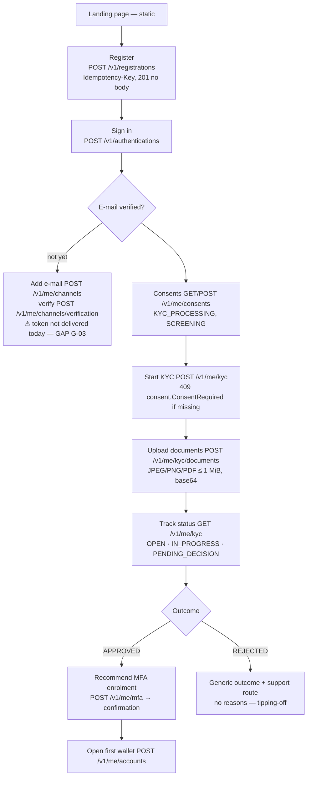
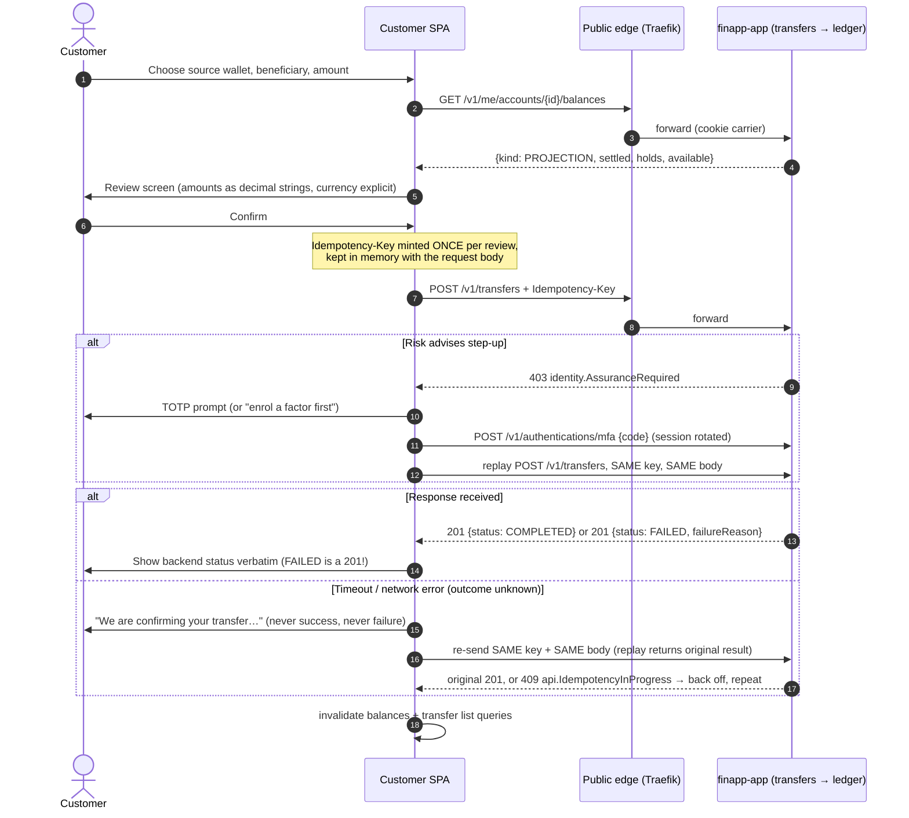
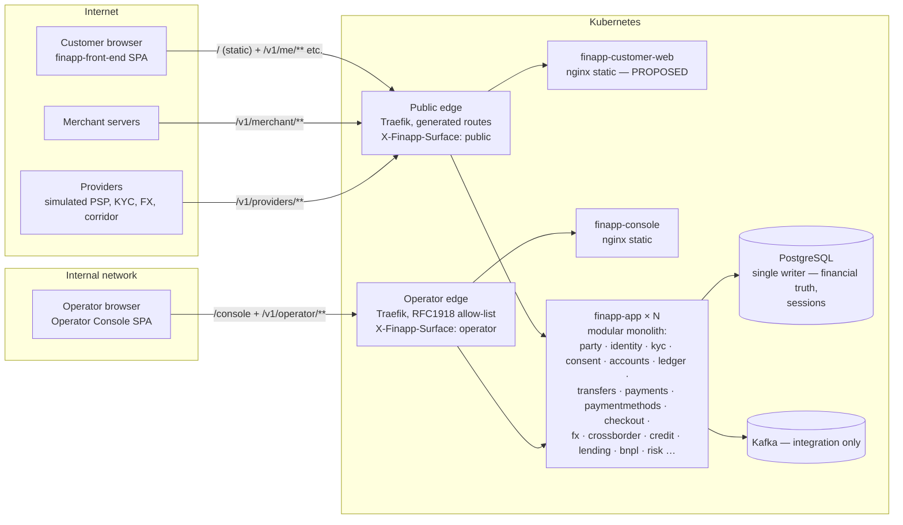
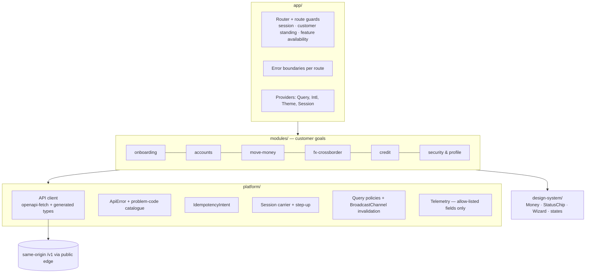

# FinApp Customer Application — Discovery, Architecture and Implementation Blueprint

| | |
|---|---|
| **Status** | **APPROVED by the owner, 2026-11-19 ("Approve all")** — decisions D-A…D-H (§20) decided at their recommendations. The phase's record is now [`PHASE_18_PLAN.md`](PHASE_18_PLAN.md); where the two differ, the plan is right. ADR-F01…F08 are written (`Proposed` until `P18-INIT`). |
| **Date** | 2026-11-19 |
| **Read against** | `finapp` master `5227f57e2` (Phase 16 `IN_REVIEW`); `finapp-admin-panel` master `5cd1d5b` (Phase 17 console) |
| **Scope of this task** | Discovery and architecture only. No application code, no dependencies installed, no backend change, no phase or task status changed. |

Paths written `finapp:…` are in `F:\projects\IdeaProjects\finapp`; `console:…` are in `F:\projects\IdeaProjects\finapp-admin-panel`.

---

## 0. Corrections to the brief — read these first

The brief describes the platform as "Java microservices" fronted by an "API Gateway" with "Spring Authorization Server, OAuth2/OIDC, JWKS". The repository says otherwise, and the blueprint is built on what the repository says:

| Brief assumed | Repository fact | Evidence |
|---|---|---|
| Independent Java microservices | **One modular monolith** (`finapp-app` image, N ≥ 3 replicas, one PostgreSQL writer). An accepted ADR rules out extracting any module. | `finapp:docs/adr/ADR-0001`, `ADR-0151` (Accepted 2026-11-16), `docs/architecture/SYSTEM_ARCHITECTURE.md` |
| API Gateway | **No gateway.** Two Traefik edges (public, operator) whose route tables are *generated from code* by `EdgeAllowListTest`. The edge authenticates nothing. | `finapp:deploy/edge/base/*`, `CAPABILITY_MAP.md` §Platform, `ADR-0147` |
| Spring Authorization Server / OAuth2 / OIDC / JWT / JWKS | **None exists, by decision.** Server-side PostgreSQL sessions with an opaque bearer token; JWT and external IdP options were explicitly rejected. No Spring Security web layer — hand-rolled interceptors. | `finapp:ADR-0030`, `ADR-0032` (Option C rejected), `identity/build.gradle.kts`, `app/.../session/SessionAuthenticationInterceptor.java` |
| Passkeys/WebAuthn | Not built. `STRONG` assurance rung reserved, nothing issues it. | `finapp:identity/.../AssuranceLevel.java`, `PHASE_1_PLAN.md` |
| Cards (issuing), investments | **Card issuing is external** (ADR-0059 §5). **Investments do not exist** anywhere in the product. | `finapp:docs/project/DELIVERY_PLAN.md` L685 |
| Notifications, support | No backend capability. "Notification" is only a platform heading. No notifier delivers recovery or verification tokens today. | `finapp:CAPABILITY_MAP.md` L387, `THREAT_MODEL.md` item (f) |
| Business customers with members and roles | One organisation ↔ **one acting person** (the registrant). No members, roles, mandates, or "act as organisation". Organisation accounts are not reachable from a customer session. | `finapp:app/.../kyc/OrganisationController.java` L25-45 |
| Production financial product | finapp is a **reference platform**: simulated providers, no real funds, no jurisdiction fully complied with. Credit/lending/BNPL answer `ProductNotOffered` in production; risk answers `ALLOW / NO_POLICY_ACTIVE`. | `finapp:docs/product/ROADMAP.md` §Non-Goals, `CAPABILITY_MAP.md` |

The architectural consequence is significant: **the "BFF + OAuth2 Authorization Code + PKCE" pattern the brief anticipates has no authorization server to talk to.** The right question is not "which OAuth flow" but "which carrier for finapp's own opaque session token" (§12).

---

## 1. Executive summary

**Product.** A single responsive web application — *FinApp for customers* — through which a person registers, verifies their identity, opens multi-currency wallets, sees balances and statements, moves money (internal transfers, top-ups, withdrawals, FX conversion, cross-border payments), applies for and services credit (loans, revolving line, BNPL), and manages their security, sessions and consents. A business registrant can register an organisation and complete KYB ownership declaration; full business banking waits on backend work.

**Recommended architecture.**
- A static **Vite + React + TypeScript SPA** in its own repository (this one, `finapp-front-end`), deployed as a fourth deployable `finapp-customer-web` (nginx-unprivileged, no secrets, no egress), **served same-origin through finapp's public edge**. No CORS, no new origin.
- **No BFF and no new backend service.** The monolith already exposes a purpose-built customer surface (`/v1/me/**` and friends, ~97 operations). Gaps are closed by the *owning module* adding a customer read or command — the precedent set by the console (ADR-C130).
- **Session carrier: finapp's opaque session token moved into an `HttpOnly; Secure; SameSite=Strict` cookie** issued by the monolith on the public surface, with a CSRF defence (custom request header + `Origin` check). The token stays server-side-judged in PostgreSQL, revocable instantly (ADR-0030 unchanged). This is a *backend* decision for the owner (proposed ADR-F02); the fallback is the console's in-memory token.
- **Stack:** React 19, TypeScript strict, Vite 8, **Mantine 9** (same as the console, already proven under `style-src 'self'` + Trusted Types), TanStack Query + TanStack Router, React Hook Form + Zod, openapi-typescript + openapi-fetch against the pinned contract, FormatJS for messages, `Intl.NumberFormat` on decimal strings for money. No template.

**First stage.** Stage 1 (foundation) needs no backend change and can start on approval. Stage 2 (sign-in and onboarding) is blocked by five backend items, the most important being the cookie carrier, a public-edge SPA route, and a notification channel for e-mail verification and password recovery.

**Governance.** Treat the customer application as **Phase 18** of the finapp programme, governed in this repository exactly as the console governs Phase 17 (plan, backlog, ADRs, DoD here; backend tasks in finapp under finapp's process), with an owner-granted pre-phase allowance for Stage 1 like the console's D-1.

---

## 2. Repository investigation — what exists

### 2.1 The platform

| Item | Finding |
|---|---|
| Current phase | Phases 0–15 `COMPLETE`; **Phase 16 `IN_REVIEW`** awaiting the owner's flip. Cross-cutting `X-TSK-024…028` `PLANNED`. (`finapp:docs/project/CURRENT_STATE.md`) |
| Phase 17 | The Operator Console, governed in `finapp-admin-panel/docs` (milestones M0–M11, many started early under D-12…D-23). Not yet recorded in finapp's ROADMAP on master. Its plan names `finapp-front-end` as "a future customer-facing app … out of scope" (`console:docs/PHASE_17_PLAN.md` §2.1). |
| Customer UI plans in finapp | **None.** No roadmap entry, no edge route, no deployable. |
| Modules | party, identity, kyc, consent, accounts, ledger, transfers, payments, paymentmethods, checkout, merchant, settlement, reconciliation, fx, crossborder, credit, creditmath, lending, bnpl, risk, accounting — all controllers live in `app/`. |
| Contract | `finapp:docs/api/openapi.json`, OpenAPI 3.1, **440 operations**: 314 operator, 21 merchant, 5 webhooks (2 missing from the contract), 5 public, **~97 customer-session**. |
| Contract quality issues | No `securitySchemes`; no per-operation error responses (368 problem codes in `components.responses`, none referenced); only 13 enums — **status fields are plain `string`** in the contract. |
| Rules a frontend inherits | Money never a float (`CLAUDE.md` rule 1); state machines are the backend's; Kafka/caches are never truth; data classification `RESTRICTED-FINANCIAL` / `RESTRICTED-PII` never in logs (`DATA_CLASSIFICATION.md`); risk/AML never visible to a customer (`INV-RSK-08`, `NoCustomerSurfaceReadsRiskTest`). |

### 2.2 The console (what to learn, what not to share)

The console (React 19.3, Vite 8.3, Mantine 9.8, TanStack Query/Router/Table, openapi-fetch, exact pins, licence allow-list, CSP with Trusted Types, money-lint rules, module-boundary lint) is a strong, recent precedent. **Reuse its patterns and tooling decisions; do not share its code, origin, edge, permissions or screens.** A shared package is deferred (proposed ADR-F08).

---

## 3. Customer personas

Personas are restricted to what the domain supports (`PartyKind ∈ {PERSON, ORGANISATION}`, `CustomerStatus ∈ {PENDING, ACTIVE, SUSPENDED, CLOSED, REJECTED}`, customers hold **no roles** — ADR-0031).

| # | Persona | Supported? | Needs | Gate |
|---|---|---|---|---|
| P1 | **Prospect** | Partly — no public product pages exist in the backend (static content only) | Understand the offer, register | none |
| P2 | **Registered, not verified** (CustomerStatus `PENDING`) | Yes | Grant consents, start KYC, upload documents, see progress | session (`PASSWORD`) |
| P3 | **Verified personal customer** (`ACTIVE`, KYC `APPROVED`) | Yes | Wallets, balances, statements, transfers, top-up, withdraw, FX, cross-border | session; conditional / risk-advised step-up per operation |
| P4 | **Credit customer** | Yes (non-production only — production answers `lending.ProductNotOffered`) | Credit decision, loan application, offer acceptance, repayments, payoff; BNPL agreements, repayments, disputes | `MULTI_FACTOR` on submission/acceptance/payoff/draw; consent `CREDIT_BUREAU_ACCESS` |
| P5 | **Suspended customer** | Yes (status only) | Understand they are restricted, contact support | read-only; no reason shown (tipping-off) |
| P6 | **Business registrant** | Partly | Register organisation, declare beneficial owners, see KYB status | session; one acting person only |
| P7 | Organisation member / employee with limited permissions / authorised representative | **Missing** | — | Needs ADR-0031's `authorization` module split; out of scope until backend exists |
| — | Merchant | **Not a customer-app persona.** Merchants are machine API keys administered by operators (ADR-0052). | — | — |

**Recommendation: one application.** Individuals and the business registrant share identity, session, consent and KYC/KYB journeys; the business persona today is a *KYB onboarding extension*, not a separate banking experience. When organisation membership arrives, add an "acting for" context switch inside the same app, not a second app.

---

## 4. Customer journeys

### 4.1 Onboarding (individual) — what the backend enforces, in order



Personal data (name, address, DOB) is **not collected through any API** — `PATCH /v1/me` edits only `displayName`, and KYC is document-driven. This is gap G-07; the journey cannot ask for an address until a module owns it.

### 4.2 Business onboarding

Register person → sign in → `POST /v1/me/organisations {name}` → consents → `GET /v1/me/kyb` → declare owners `POST /v1/me/kyb/owners {ownerPartyId, controlRole, stakeBasisPoints}` → track KYB status. **`ownerPartyId` requires the owner to already be a Party** — how a customer obtains another person's party id is undefined (gap G-09).

### 4.3 Internal transfer (the reference money-moving journey)



### 4.4 Cross-border payment (asynchronous)

Corridors `GET /v1/me/cross-border/corridors` → beneficiary (`PENDING_VERIFICATION → ACTIVE`) → quote `POST /v1/me/cross-border/quotes` (fee, totalDebit, customerRate, `expiresAt`) → review with a live expiry countdown → `POST /v1/me/cross-border/payments` (**202**) → poll `GET …/payments/{id}`: `PROCESSING → SENT → DELIVERED | RETURNED | FAILED`. Quote expiry (`fx.QuoteExpired` / stale policy 409) sends the customer back to re-quote; the UI never re-uses an expired quote or computes a fee.

### 4.5 FX conversion

Pairs → quote (`fixedSide` source or destination) → review (`customerRate`, `disclosedMarginOverMid`, `expiresAt`) → `POST /v1/me/fx/conversions {quoteId}` → `BOOKED`. `503 fx.RateUnavailable` means *no rate*, never a cached one.

### 4.6 Loan

Consent `CREDIT_BUREAU_ACCESS` → (optional) credit decision request → `POST /v1/me/loan-applications` (202, `MULTI_FACTOR`) → poll to `OFFERED` → offer screen with document + illustration schedule → accept echoing `termsSha256` (`MULTI_FACTOR`; `lending.TermsChanged` 409 forces re-read) → loan `PENDING_DISBURSEMENT → ACTIVE` → schedule, statements, repayments, payoff quote → payoff.

---

## 5. Functional scope and prioritisation

Legend — **Backend:** ✅ implemented · ◐ partial · ○ planned · ✗ missing · ? requires investigation.

| Module | Backend | Release | Notes |
|---|---|---|---|
| Public entry (static pages) | n/a | R1 | Static content only, no API |
| Registration, sign-in, sign-out | ✅ | R1 | |
| E-mail verification, password recovery | ◐ endpoints exist, **no delivery** | R1 *blocked* | G-03 |
| MFA (TOTP) enrol + step-up | ✅ (enrol only; no removal / recovery codes) | R1 | G-11 |
| Passkeys | ✗ | later | needs ADR in finapp |
| Consents | ✅ | R1 | |
| KYC (documents, status) | ✅ | R1 | personal data capture ✗ (G-07) |
| KYB (organisation, owners) | ◐ | R1 | single registrant only |
| Dashboard | ◐ composed from wallets + balances + lists | R2 | needs G-01, G-02 |
| Wallets: open, add currency, close, balances | ✅ | R2 | |
| Statements | ✅ (JSON, date range, unpaginated) | R2 | no PDF (G-05) |
| Activity feed / search / filter | ✗ | R2 *degraded* | G-02 |
| Account identifiers for receiving funds | ✗ | — | G-06 |
| Beneficiaries (internal) | ✅ (POST has no idempotency key) | R3 | G-12 |
| Internal transfers | ✅ | R3 | |
| Top-up by card / bank (payments) | ✅ API; card tokenisation in browser **?** | R3 | G-10 |
| Payment methods (card token, bank account) | ✅ | R3 | |
| Withdrawals | ✅ (no list) | R3 | G-01 |
| Scheduled / recurring payments | ✗ | — | ADR-0044: arrives with scheduled transfers |
| FX conversion | ✅ | R3 | |
| Cross-border | ✅ | R3 | |
| Credit decision, loans, revolving line | ✅ (non-prod) | R4 | production gated |
| BNPL agreements, repayments, disputes | ✅ (dispute read ✗) | R4 | BNPL *origination* happens in merchant checkout |
| Checkout confirmation (shopper) | ✅ | R4 | reached from a merchant redirect |
| Sessions & devices | ✅ (sessions; no device registry) | R1 | |
| Notifications | ✗ | — | G-03 |
| Support, complaints, card disputes | ✗ | — | G-13 |
| Cards (issuing), investments | ✗ out of product scope | **never in this plan** | |

---

## 6. Navigation and screen inventory

**Primary navigation (signed in, verified):** Home · Accounts · Move money · Credit (shown only if the customer has a loan, BNPL agreement or eligible product) · Profile & security. Mobile: bottom tab bar with the same five entries; "Move money" opens an action sheet.

**Restricted navigation (signed in, not verified):** Onboarding checklist · Profile & security · Sign out. Money screens are not linked — and the backend refuses them anyway.

| Area | Screens |
|---|---|
| Public | Landing · Sign in · Register · Forgot password · Reset password · Verify e-mail (token link) · Session expired · Maintenance |
| Onboarding | Checklist (progress) · Consents · Identity documents · Verification status · Organisation registration · Beneficial owners |
| Home | Dashboard: wallets with available balance, required actions, recent transfers/payments, credit summary |
| Accounts | Wallet list · Wallet detail (per-currency settled / holds / available) · Statement (date range, per currency) · Open wallet · Add currency · Close wallet |
| Move money | Transfer (form → review → result) · Beneficiaries · Top up · Withdraw · Convert currency · Send abroad (corridor → beneficiary → quote → review → tracking) · Payment methods · Transfer / payment / withdrawal detail with status timeline |
| Credit | Credit profile · Apply for loan · Application status · Offer review & accept · Loan detail · Schedule · Repay · Payoff quote · Draw (revolving) · Statements · Amendments · BNPL agreements · BNPL detail / schedule / repay / dispute |
| Profile & security | Profile · E-mail · Password · Two-step verification · Active sessions · Consents · Sign out everywhere |
| System | Not found · Forbidden · Feature unavailable (module down) · Unknown-outcome reconciliation · Step-up dialog |

### 6.1 Low-fidelity layouts

**Dashboard (desktop, 12-col):**
```
┌ Header: logo · nav · notifications(slot, disabled) · profile ┐
│ [Required actions banner — e.g. "Finish verification", "Enable two-step"]│
│ ┌ Wallet card EUR ─────┐ ┌ Wallet card USD ─────┐ ┌ + Open wallet ┐ │
│ │ Available 1 204.50 €  │ │ Available 310.00 $    │                 │
│ │ Settled 1 254.50 · Held 50.00 · as of 12:04 │                     │
│ └───────────────────────┘ └───────────────────────┘                 │
│ ┌ Quick actions: Transfer · Top up · Convert · Send abroad ┐        │
│ ┌ Recent activity (transfers + payments, labelled by source) ┐      │
│ ┌ Credit: next instalment due 2026-12-01 · 120.00 €  ┐ (if any)     │
└───────────────────────────────────────────────────────────────────┘
```
Mobile: single column, wallet cards as a horizontal carousel, quick actions as a 4-icon row.

**Review & confirm (every money-moving command):**
```
You are sending        150.00 EUR      from  Main wallet (EUR)
To                     Ana K. (beneficiary)
Fee                    —  (shown only if the backend returned one)
Rate                   — / 1 EUR = 1.0832 USD (quote expires in 0:42)
Recipient gets         162.48 USD
[ Back ]                                   [ Confirm and send ]
```
Every figure on this screen comes from a backend response. Nothing is computed client-side.

**Result:** status chip from the backend enum, the correlation id ("Reference for support"), next actions. A pending or unknown outcome has its own screen and never shows the success illustration.

---

## 7. UX and design-system proposal

- **Tone:** consumer-grade, calm, plain language; not the console's dense operator style. Same Mantine engine, **different theme and component layer** (own tokens: larger type scale, 44 px touch targets, generous spacing).
- **Value components** (rebuilt here, modelled on the console's): `Money` (decimal string + ISO currency → `Intl.NumberFormat`, never `Number`), `MoneyInput` (string-in/string-out, scale from currency minor units), `Rate` (as returned, with source/destination), `BalanceTriplet` (available prominent; settled and holds labelled — never summed by the client), `StatusChip` (exhaustive per-enum map with customer wording; unknown values render "In progress — check back" not an error), `Countdown` (quote `expiresAt` against server-provided time, see §15), `CorrelationReference`.
- **State components:** `Loading`, `Empty`, `ErrorExplained` (code → message + next step), `FeatureUnavailable` (503 for one module), `UnknownOutcome`, `StepUpDialog`, `SessionExpiring`.
- **Workflow components:** `Wizard` (stepper with persistence only in memory), `ReviewPanel`, `ResultPanel`, `ConfirmDangerous` (close wallet, revoke beneficiary, withdraw application).
- **Rules:** explicit primary action per screen; destructive actions secondary and confirmed; fees/rates before confirmation; no optimistic financial UI; errors say what happened and what to do; no internal codes shown except the correlation reference; WCAG 2.2 AA from the first component (axe in CI, keyboard paths, focus management in dialogs, `prefers-reduced-motion`).

---

## 8. Frontend technology comparison

Versions and licences as researched on 2026-11-19 (npm registry, official docs). Re-verify at Stage 1.

| Option | Licence | CSP fit (`style-src 'self'`, Trusted Types) | A11y | Forms / inputs | Verdict |
|---|---|---|---|---|---|
| **Mantine 9.8** | MIT, no paid tier | **Good with discipline** — static CSS; theme vars as a generated stylesheet; ban components that inject `<style>` (console has done exactly this and proved it in a CSP browser test) | Good; no published SR matrix | Strong (`NumberInput`, dates, combobox) | **Recommended** — proven in this programme |
| React Aria Components 1.22 + Tailwind 4 / CSS Modules | Apache-2.0 / MIT | Excellent — no runtime CSS | **Best documented** (VO, JAWS, NVDA, TalkBack) | Excellent locale-aware `NumberField`, dates | **Fallback** — more design-system work |
| shadcn/ui (Base UI / Radix) + Tailwind | MIT | Good; Base UI needs `CSPProvider` | Good, but you own the copied source | Assemble yourself | Viable; ownership cost |
| MUI 9 (+ MUI X) | MIT; MUI X Pro/Premium commercial | **Poor** — Emotion runtime needs nonces and `style-src-attr 'unsafe-inline'` | Good | Excellent | Rejected |
| Ant Design 6 | MIT | Possible only in `zeroRuntime` mode | Less documented | Excellent | Rejected — enterprise/admin look |
| Chakra UI 3 | MIT | Poor (Emotion) | Good | Good | Rejected |

| App framework | Verdict |
|---|---|
| **Vite 8 + React 19 SPA** | **Recommended.** Static assets behind nginx; strict CSP without nonces; matches the console. |
| Next.js 16 | Rejected. Nonce CSP forces fully dynamic rendering; Next becomes a Node tier holding the session — an unwanted second backend. SEO need is limited to static marketing pages. |
| Router: **TanStack Router 1.x** vs React Router 8 | **TanStack Router** for parity with the console and typed search params; React Router 8 is an equally sound alternative. TanStack *Start* rejected (weeks-old stable). |

| Concern | Choice | Why |
|---|---|---|
| Server state | TanStack Query 5 | console parity; per-query freshness policies |
| API client | openapi-typescript 7 + openapi-fetch 0.17, pinned contract | console parity; compile error on contract drift |
| Forms | React Hook Form 7 + Zod 4 | mature; Zod validates *shape*, never business rules |
| i18n | FormatJS (react-intl) | ICU messages for regulated wording; `Intl` for money/dates |
| Money arithmetic | **none** by default; `big.js` only if a non-authoritative preview is ever approved | backend computes everything |
| Testing | Vitest, Testing Library, MSW (tests only), Playwright + axe | console parity |
| PWA | **Not in R1.** Manifest allowed later; **no service worker caching of API responses** | §16 |

### 8.1 Templates

No credible open-source *customer-facing* banking template exists. Candidates found are admin dashboards (Mantine admin, MUI templates, TailAdmin, shadcn-admin — wrong audience), tutorial starters (e.g. Next.js "Horizon" banking demo — not production), or useful *references* (ING `lion` accessible white-label components, MIT; GOV.UK Design System patterns; Mifos mobile flows, MPL-2.0 — reference only). AGPL projects (e.g. Midday) are licence-incompatible.

**Recommendations:** best overall — Mantine 9 + own customer design layer; best open-source — same (MIT throughout); best long-term enterprise maintenance — Mantine (shared skills and tooling with the console) with React Aria as a documented exit; best for FinApp's actual requirements — Mantine, because the strict CSP and the console's proven lint/catalogue gates transfer directly. **No template; no purchase.**

---

## 9. Repository and project structure

**Recommendation: this directory, `finapp-front-end`, becomes a dedicated repository** (it is currently empty and not a git repository). Rationale: finapp is Java/Gradle with its own gates; the console set the precedent of a separate repo per frontend (ADR-C130); release cadence and supply chain differ.

```
finapp-front-end/
  contract/            openapi.json pinned by commit + sha256 (contract:pull / generate / check)
  config/              customer-web-headers.mjs (CSP), nginx.conf
  docs/                PHASE_18_PLAN.md, BACKLOG.md, DECISIONS.md, adr/ADR-F01…, DEFINITION_OF_DONE.md,
                       FINAPP_BACKEND_WORK.md, this blueprint
  src/
    app/               shell, router, route guards, providers, error boundary
    platform/
      api/             client, ApiError, idempotency, retry policy, problem-code catalogue
      session/         carrier, step-up, expiry warning, sign-out-everywhere
      query/           QueryClient, freshness policies, cross-tab invalidation
      i18n/  telemetry/  format/
    design-system/     tokens, Money, MoneyInput, StatusChip, states, Wizard, ReviewPanel …
    modules/           onboarding/ accounts/ move-money/ fx-crossborder/ credit/ security/ profile/
    generated/         finapp-api.ts (types only)
  catalogue/           component catalogue (axe + CSP run)
  e2e/  tests/  scripts/
```

Module boundaries enforced by lint (no `modules/a` → `modules/b` import). Modules map to **customer goals**, not backend modules: e.g. `move-money` consumes transfers, payments, paymentmethods; `credit` consumes credit, lending, bnpl.

---

## 10. Architecture diagrams

### 10.1 System context



The customer app never reaches PostgreSQL, Kafka or any management port; its only path is the public edge's generated allow-list.

### 10.2 Frontend component architecture



---

## 11. Backend integration architecture

- **One boundary:** same-origin `/v1/**` through the public edge's generated routes. No direct service, database, broker, object store or management access.
- **No BFF.** A BFF would hold sessions (new stateful, multi-instance tier), duplicate the edge's rate limiting and the monolith's authentication, and invite aggregation logic that belongs to owning modules. The single legitimate BFF concern — keeping the token away from JavaScript — is solved by the cookie carrier inside the monolith (§12). Revisit only if a native mobile app needs a materially different API shape.
- **Gaps are closed in the owning module** (e.g. activity feed in transfers/payments or a ledger-derived read; pagination per module). Each gap is a finapp task with its own DoD, listed in §14 and `FINAPP_BACKEND_WORK.md` (to be created at Stage 0 exit).
- **Contract:** pin `finapp:docs/api/openapi.json` by commit + sha256; generate types; fail CI on drift. Request three non-breaking contract improvements (G-14): `securitySchemes`, status `enum`s, and per-operation problem codes.

### 11.1 Handling rules (all derived from `API_CONVENTIONS.md` / `ERROR_CONTRACT.md`)

| Situation | Behaviour |
|---|---|
| Versioning | `/v1` only; react to `Deprecation`/`Sunset` headers when implemented (decided, not built) |
| Pagination | Customer lists are unpaginated today (bare arrays / wrappers / `truncated` flags). Render `truncated` honestly ("showing the latest 100"); adopt `{items, nextCursor}` when §7 lands (G-01) |
| Sorting / filtering | Only what the server offers; **no client-side re-sorting of financial lists** beyond display of a server-ordered list |
| Validation | `400` unparseable → bug report; `422 api.ValidationFailed` → field messages; client Zod checks are UX only |
| Authentication failure | `401 api.Unauthenticated` (any cause) → clear session state, route to sign-in with return path (validated, same-origin) |
| Authorisation | `403 identity.AssuranceRequired` → step-up then replay **once** with the same key; `403 api.Forbidden` → explain, no retry; `404 api.NotFound` (also "not yours") → generic not found |
| Rate limits | `429 api.TooManyRequests` honour `Retry-After`; `fx.TooManyOpenQuotes` → explain |
| Overload / unavailable | `503 api.Overloaded` / `api.TemporarilyUnavailable` / `*.ProviderUnavailable` → "nothing was done"; retry with same key after `Retry-After` |
| Idempotency | `409 api.IdempotencyInProgress` → wait and re-send the same request; `409 api.Conflict` (same key, different body) → client bug, never auto-resolve |
| Concurrency | No ETag/If-Match exists. Freshness is carried in the body: quote ids + `expiresAt`, `termsSha256`, payoff quotes. Stale codes (`fx.QuoteExpired`, `*.PolicyStale`, `*.PayoffQuoteStale`, `*.TermsChanged`, `credit.DataStale`) → re-read and re-review |
| Timeouts | 30 s client timeout on commands → **unknown outcome**, not failure |
| Reads | retry with backoff (idempotent GETs only) |
| Commands | never auto-retried except the explicit unknown-outcome reconciliation with the same key |

---

## 12. Authentication and authorization architecture

### 12.1 What the backend gives us

- `POST /v1/authentications` → `{sessionToken, assurance, expiresAt(idle)}`; opaque token judged in PostgreSQL on every request; **idle 30 min, absolute 12 h**, idle extended on use, both on the database clock.
- Step-up: `POST /v1/authentications/mfa {code}` returns a **new token** (`PASSWORD → MULTI_FACTOR`).
- Password change rotates the token and revokes every other session.
- Sessions: `GET /v1/sessions`, `DELETE /v1/sessions/{id}`, `DELETE /v1/sessions/current`.
- Uniform `401 identity.AuthenticationFailed` (no enumeration), lockout 10 failures / 15 min, per-source limits in PostgreSQL and at the edge.
- Staff identities are refused on the public surface.

### 12.2 Carrier options

| | A. Token in JS memory (console ADR-C131) | **B. HttpOnly cookie carrier in the monolith (recommended)** | C. Session-holding BFF (OAuth-style) |
|---|---|---|---|
| XSS steals token | Yes (memory readable by injected script) | **No** (HttpOnly) — XSS can still *ride* the session while the page is open | No |
| Reload / new tab | **Signs the customer out** — unacceptable consumer UX | Survives | Survives |
| CSRF | Not applicable | Must be defended: `SameSite=Strict` + required custom header (`X-Finapp-Request: 1`) + `Origin` check on unsafe methods | Same |
| Backend change | None | Interceptor accepts the cookie on the `public` surface only; login/MFA/credential responses `Set-Cookie`; logout clears; ADR amending ADR-0030/C131 | New service + session store; contradicts ADR-0030's rationale and "no Redis" |
| Revocation | Immediate (server-side) | Immediate (unchanged) | Two layers to revoke |
| Native mobile later | Bearer header (already supported) | Mobile keeps using the Bearer header — both carriers coexist | — |

The IETF browser-apps BCP and OWASP both favour keeping credentials out of JavaScript-readable storage; for finapp that is achieved by **B without introducing an authorization server or BFF**. B is a backend decision (proposed ADR-F02, implemented as a finapp task). If the owner declines B, the app ships with A and accepts sign-out on reload (documented UX cost).

### 12.3 Authentication sequence (option B)

```mermaid
sequenceDiagram
  autonumber
  actor C as Customer
  participant UI as SPA (same origin)
  participant E as Public edge
  participant M as finapp-app (identity)
  participant DB as PostgreSQL
  C->>UI: login identifier + password
  UI->>E: POST /v1/authentications (X-Finapp-Request: 1)
  E->>M: forward (rate-limited door, surface=public)
  M->>DB: verify Argon2id, create session (idle 30m / abs 12h)
  M-->>UI: 201 {assurance, expiresAt} + Set-Cookie: fa_session=…; HttpOnly; Secure; SameSite=Strict; Path=/v1
  Note over UI: UI never sees the token. It keeps assurance + expiresAt only.
  UI->>E: GET /v1/me (cookie + X-Finapp-Request)
  M->>DB: judge session, extend idle bound
  M-->>UI: profile
  C->>UI: sensitive action
  UI->>M: POST … → 403 identity.AssuranceRequired
  UI->>C: TOTP dialog
  UI->>M: POST /v1/authentications/mfa {code}
  M-->>UI: 2xx {assurance: MULTI_FACTOR} + Set-Cookie (rotated)
  UI->>M: replay original command, same Idempotency-Key
  C->>UI: Sign out
  UI->>M: DELETE /v1/sessions/current → session revoked + cookie cleared
  UI->>UI: clear query cache, BroadcastChannel "signed-out" to other tabs
```

### 12.4 Session behaviour in the UI

- Show a warning at idle − 2 min; any activity extends the server bound; at expiry, preserve **no** form data containing amounts beyond memory, route to sign-in.
- Absolute expiry (12 h) cannot be extended — warn ahead.
- **Expiry mid-payment:** the unsent review is discarded; a sent command with an unknown outcome is reconciled after re-authentication by re-sending the same key (the key and body survive only in memory of the same tab; if the tab is lost, the customer is directed to the transfer list — this is why a list endpoint matters).
- Cross-tab: `BroadcastChannel` for sign-out and cache invalidation; never for data.

### 12.5 Authorization in the UI

- Customers hold no roles; **visibility is driven by customer standing** (customer status, KYC/KYB status, MFA enrolment, consent state, product availability) — read from the backend, never inferred from local state. Currently customer status is not exposed by `GET /v1/me` (G-08).
- Hiding a control is UX only. Every operation is authorised by the backend (RBAC boundary + ownership check, `OwnershipIsScopedTest`, uniform 404).
- IDs in URLs are opaque typed ids; the UI never assumes access because an id is known.
- Permission/standing change mid-session (e.g. suspension, revoked session): the next call returns 401/403/404 → refresh standing, re-route, never retry blindly.
- Business: one acting person per organisation. No "act as organisation" until the backend introduces mandates (ADR-0031 split trigger) — G-09.

### 12.6 Browser hardening

| Threat | Control |
|---|---|
| XSS | React escaping; lint bans `dangerouslySetInnerHTML`, `innerHTML`, `eval`, `new Function`; CSP `default-src 'none'; script-src 'self'; style-src 'self'; img-src 'self' data:; font-src 'self'; connect-src 'self'; form-action 'self'; base-uri 'none'; frame-ancestors 'none'; require-trusted-types-for 'script'; trusted-types 'none'` (console baseline; card tokenisation may add a PSP `frame-src` — G-10) |
| CSRF | Option B controls above |
| Clickjacking | `frame-ancestors 'none'`, `X-Frame-Options: DENY` |
| Session fixation | Server rotates token on login, step-up, credential change (already) |
| Token theft | HttpOnly cookie; no token in storage, URL, logs, telemetry |
| Open redirect | Post-login `returnTo` restricted to an allow-list of in-app route ids |
| Broken access control | Backend-only enforcement; E2E tests swap ids across two test customers |
| API abuse | Edge + application rate limits; UI debounces and disables in-flight submits |
| Sensitive data exposure | `Cache-Control: no-store` on API (exists on console path; add for customer routes); no persistent storage of API data; masked identifiers |
| Insecure storage | `localStorage` only for non-sensitive preferences (language, theme); lint rule forbidding storage of query data |

---

## 13. Financial correctness and distributed-system behaviour

| Condition | Frontend behaviour |
|---|---|
| Duplicate submit (double click, Enter + click) | Button disabled on first submit; one `IdempotencyIntent` per review screen; a second submit re-uses the same key |
| Retry same logical operation | Same key, **same body** (body frozen at review) |
| Response lost after backend success | Unknown-outcome screen → same-key replay returns the original result |
| Out-of-order responses | Query keys + `AbortController`; a later response for an older request is dropped; status only advances as the backend reports |
| Multiple tabs/devices | Server is authoritative; after any command, invalidate balances/lists in all tabs; never merge local state |
| Stale data | Every balance shows `as of` (response time); refetch on focus and after commands; balances labelled `PROJECTION` per ADR-0009 ("a balance must say what kind of number it is") |
| Async processing | 202 responses → status page with polling (bounded backoff, stop on terminal state, resume on focus) |
| Long-pending (`PROCESSING`, `UNKNOWN`, `HELD`, `SENT`) | Explain plainly, show since-when, offer reference for support; `HELD` shows no reason |
| Expired quote | Countdown from `expiresAt`; at expiry disable confirm; on `fx.QuoteExpired` re-quote |
| Version conflicts | `termsSha256` / payoff quote / policy staleness → re-read and re-review; never auto-accept new terms |
| Permission revoked mid-session | Next call fails → standing refresh → re-route |

**Money representation.** Amounts are decimal **strings** + ISO 4217 code end to end. Formatting via `Intl.NumberFormat(locale, {style:'currency', currency})` on the string (ES2023 string input — verify engine support in Stage 1; fall back to string-split formatting as the console does). Minor-unit scale comes from the currency (JPY 0, EUR 2, BHD 3). Rates displayed exactly as returned (no rounding beyond the backend's scale). Percentages from basis points (`stakeBasisPoints`) formatted by integer string arithmetic. Dates: business dates (`postingDate`, `valueDate`, due dates) are **dates without time zone** — render as-is, never through `new Date()` local conversion; instants in the customer's locale/time zone with an explicit zone label on receipts. Lint bans `parseFloat`, `Number(…amount)`, unary `+amount` (console rules).

**Never in the frontend:** balances, fees, FX amounts, interest, schedules, payoff amounts, eligibility, credit decisions, statuses.

---

## 14. API capability and gap matrix

Full contract inventory: 440 operations; customer-session ≈ 97. Abbreviations: S = session; MFA = always `MULTI_FACTOR`; Cond = step-up if a factor is enrolled; Risk = risk-advised step-up; Idem = `Idempotency-Key` required.

| Feature | Journey | Owner | Existing API | Vis. | Authorization | Backend | Frontend | Gap | Dependencies |
|---|---|---|---|---|---|---|---|---|---|
| Register | Become a user | party/identity | `POST /v1/registrations` (Idem) | public | none, rate-limited | ✅ | Ready | — | — |
| Sign in / out | Access | identity | `POST /v1/authentications`, `DELETE /v1/sessions/current` | public / S | — | ✅ | Blocked on carrier decision | G-04 | edge route G-15 |
| Step-up | Sensitive action | identity | `POST /v1/authentications/mfa` | S | — | ✅ | Ready | — | — |
| MFA enrol | Secure account | identity | `POST /v1/me/mfa`, `…/confirmation` | S | — | ◐ no removal/recovery codes | Ready | G-11 | — |
| Change password | Security | identity | `POST /v1/me/credential` | S | Cond | ✅ | Ready | — | — |
| Password recovery | Regain access | identity | `POST /v1/recoveries`, `…/{id}/completion` | public | — | ◐ no delivery | **Blocked** | G-03 | notifier |
| E-mail verify | Trust channel | identity | `POST /v1/me/channels`, `…/verification` | S / public | — | ◐ no delivery; EMAIL only | **Blocked** | G-03 | notifier |
| Sessions | Manage devices | identity | `GET /v1/sessions`, `DELETE /v1/sessions/{id}` | S | own only | ✅ (UA label, no device registry) | Ready | — | — |
| Profile | Who am I | party | `GET/PATCH /v1/me` | S | own | ◐ displayName only; no status | Requires design | G-07, G-08 | — |
| Consents | Permit processing | consent | `GET/POST /v1/me/consents`, `DELETE …/{purpose}` | S | own | ✅ | Ready | — | — |
| KYC | Get verified | kyc | `POST/GET /v1/me/kyc`, `POST /v1/me/kyc/documents` | S | own; consent-gated | ✅ (no doc list) | Ready | G-07 | consent |
| Organisation | Business onboarding | kyc/party | `POST /v1/me/organisations` | S | registrant | ◐ | Ready | G-09 | — |
| KYB owners | Declare UBOs | kyc | `GET /v1/me/kyb`, `POST /v1/me/kyb/owners` | S | registrant | ◐ party-id discovery undefined | Requires design | G-09 | — |
| Wallets | Hold money | accounts | `GET/POST /v1/me/accounts` (Idem), `DELETE …/{id}`, `POST …/{id}/currencies` (Idem) | S | own | ✅ | Ready | — | KYC |
| Balances | Know my money | ledger/accounts | `GET /v1/me/accounts/{id}/balances` | S | own | ✅ settled/holds/available | Ready | — | — |
| Statement | History | ledger/accounts | `GET /v1/me/accounts/{id}/statement?from&to` | S | own | ◐ JSON only, unpaginated | Ready (bounded ranges) | G-05, G-01 | — |
| Activity feed | What happened | transfers/payments/ledger | — | — | — | ✗ | Degraded (separate lists) | G-02 | — |
| Receive details | Get paid | accounts | — | — | — | ✗ | — | G-06 | — |
| Beneficiaries | Save payees | transfers | `GET/POST /v1/beneficiaries`, `DELETE …/{id}` | S | own | ◐ POST lacks Idem | Ready | G-12 | — |
| Internal transfer | Send money | transfers | `POST /v1/transfers` (Idem, Risk), `GET /v1/transfers[/{id}]` | S | own source | ✅ (list unbounded) | Ready | G-01 | balances |
| Top-up | Fund wallet | payments | `POST /v1/payments` (Idem, Risk), confirm, cancel, void, GET | S | own | ✅ | Requires design | G-10 | payment method |
| Payment methods | Save card/bank | paymentmethods | `GET/POST /v1/me/payment-methods`, `…/bank-accounts` (Idem), DELETE | S | Cond | ✅ API; browser tokenisation ? | **Requires investigation** | G-10 | PSP SDK |
| Withdrawal | Cash out | payments | `POST /v1/me/withdrawals` (Idem, Risk), `GET …/{id}` | S | own | ◐ no list | Ready | G-01 | bank method |
| FX conversion | Exchange | fx | pairs, quotes (Idem), cancel, conversions (Idem) | S | own | ✅ (no list) | Ready | G-01 | wallets multi-ccy |
| Cross-border | Send abroad | crossborder | corridors, beneficiaries (Idem, Risk), quotes (Idem), payments (Idem, Risk, 202), cancel | S | own | ✅ (no payment list) | Ready | G-01 | KYC screening |
| Credit decision | Know eligibility | credit | `GET /v1/me/credit/profile`, decision-requests (MFA, Idem, 202) | S | own; consent | ✅ non-prod | Ready | prod gate | consent |
| Loan apply/offer | Borrow | lending | applications (MFA, Idem), offers accept (MFA)/decline (Cond) | S | own | ✅ non-prod | Ready | prod gate | credit |
| Loan servicing | Repay | lending | loans, schedule, repayments (Cond), prepay/payoff/draw/closure (MFA), statements, amendments | S | own | ✅ | Ready | — | — |
| BNPL | Pay later | bnpl | agreements, schedule, repayments, payoff, disputes (create/withdraw) | S | own | ◐ no dispute read | Ready | G-13 | checkout origin |
| Checkout confirm | Pay a merchant | checkout | `POST /v1/checkout/sessions/confirmation`, `…/bnpl-options` | S | Risk | ✅ | Requires design | redirect contract | merchant |
| Notifications | Be informed | — | — | — | — | ✗ | — | G-03 | — |
| Support / complaints | Get help | — | — | — | — | ✗ | — | G-13 | — |
| Card issuing, investments | — | external / none | — | — | — | out of scope | — | — | — |

### 14.1 Backend gap register (proposed finapp tasks)

| ID | Gap | Proposed owner | Blocks | Priority |
|---|---|---|---|---|
| G-04 | Cookie session carrier + CSRF on the public surface (ADR) | identity / app | Stage 2 | **P0** |
| G-15 | Public-edge SPA route (`GET /`, `/assets/**` → `finapp-customer-web`), headers middleware, NetworkPolicy, admission, Argo app; `Cache-Control: no-store` on customer API routes | deploy / app (`EdgeAllowListTest`) | Stage 2 | **P0** |
| G-03 | Notification delivery for verification + recovery tokens (a notifier port + simulated adapter) | identity (platform notifier) | Stage 2 recovery & verification | **P0** |
| G-08 | Customer standing on `GET /v1/me` (customer status, kind; optional "required actions") | party | Stage 2 routing | P1 |
| G-07 | Personal data capture (legal name, DOB, address, phone) and where it lives (party vs kyc) | party / kyc (ADR) | Stage 2 completeness | P1 |
| G-01 | Cursor pagination (§7) on customer lists; list endpoints for withdrawals, FX trades, cross-border payments, applications | each owner | Stage 3–4 | P1 |
| G-02 | Customer activity read (transfers, payments, withdrawals, FX, cross-border, loan movements) — likely ledger-statement-derived per wallet with references | ledger / accounts (ADR) | Stage 3 dashboard | P1 |
| G-14 | Contract: `securitySchemes`, status `enum`s, per-operation problem codes; add 2 missing webhook routes | app | Stage 1 typing quality | P1 |
| G-10 | Browser card tokenisation path for the simulated PSP (hosted fields? CSP `frame-src`) | paymentmethods (ADR) | Stage 4 top-up by card | P2 |
| G-12 | Idempotency on `POST /v1/beneficiaries` | transfers | Stage 4 | P2 |
| G-11 | MFA factor removal / recovery codes | identity | Stage 6 | P2 |
| G-05 | Downloadable statements (PDF) | accounts/ledger | Stage 3 nice-to-have | P3 |
| G-06 | Customer-visible receiving identifiers (IBAN-like) | accounts (ADR) | Stage 3 | P3 |
| G-09 | Organisation members, mandates, "act as" | new `authorization` module per ADR-0031 | business banking | P3 (epic) |
| G-13 | Support/complaints; BNPL dispute read | new capability / bnpl | Stage 6 | P3 |

---

## 15. Privacy, compliance and trust

**Confirmed from repository documentation**
- Data classification: `RESTRICTED-PII` and `RESTRICTED-FINANCIAL` never in logs, traces, metrics or events (`DATA_CLASSIFICATION.md`, `INV-AUD-02`, ADR-0019, ADR-0072).
- Risk/AML/screening data is never shown to customers (`INV-RSK-08`); `HELD`/`FAILED` show no reason; KYC shows the customer-shaped status only.
- Consent is an append-only history per purpose and text version; login ≠ consent (`ADR-0037`, `INV-IDN-04`). The UI must show the current text and version being accepted.
- Loan/BNPL acceptance binds to `termsSha256`; the document must be shown before acceptance.
- Financial records are immutable; corrections are reversals — the UI shows reversals as separate entries.

**Potential requirements needing legal/compliance validation** (not asserted by the repo; reference jurisdiction is `EU-REF`, EUR functional currency): PSD2-style SCA for payments and account access; GDPR access/rectification/erasure requests; consumer-credit pre-contractual disclosures and withdrawal periods; cross-border fee/rate transparency rules; EAA/WCAG accessibility obligations; complaint-handling procedures; cookie consent (only strictly necessary cookies are proposed, so likely no banner).

**Engineering recommendations:** no third-party analytics in R1; first-party telemetry with an allow-list schema; correlation id on every outcome screen; client-side audit is *not* an audit trail — the backend audits; privacy notice and terms as versioned static content linked from consent screens.

---

## 16. Reliability, performance and observability

- **Deployment:** `finapp-customer-web` — nginx-unprivileged, read-only root, 2+ replicas, no egress, NetworkPolicy ingress from the public edge only, image signed and admitted by digest (console pattern). `index.html` `no-cache`; `/assets/*` immutable, content-hashed.
- **CDN:** optional later in front of the public edge for `/assets/*` only; never caches `/v1/**`.
- **Caching:** TanStack Query in memory only; balances `staleTime` 0 with refetch on focus; reference data (pairs, corridors) short TTL; no persistence plugin; no service worker in R1.
- **Degradation:** route-level error boundaries; a module returning 503 shows `FeatureUnavailable` while the rest works; the shell renders without any API call except `GET /v1/me`.
- **Budgets:** initial JS ≤ 200 kB gzip for the signed-in shell; LCP ≤ 2.5 s and INP ≤ 200 ms on a mid-range mobile (p75); route-level code splitting per module.
- **Observability:** capture `X-Correlation-Id` from every response and surface it on errors/results; send `X-Client-Correlation-Id`-compatible ids for client spans; front-end error reporting self-hosted or first-party (vendor TBD — no paid service without approval) with a scrubber that drops request bodies, amounts, ids classified `RESTRICTED-*`, and all headers; Web-Vitals as aggregate metrics.
- **Offline:** banner "You're offline — nothing will be sent"; commands disabled; never queued.

### 16.1 Deployment diagram

```mermaid
flowchart LR
  B[Customer browser] -->|HTTPS, TLS 1.2+| NLB[Internet-facing NLB]
  NLB --> T[finapp-edge-public — Traefik<br/>generated routes · rate limits · headers]
  T -->|"GET / , /assets/**"<br/>customer-web-headers (CSP)| W[finapp-customer-web × 2<br/>nginx static, no egress]
  T -->|"/v1/** allow-list"<br/>X-Finapp-Surface: public| A[finapp-app × N]
  A --> P[(PostgreSQL primary)]
  A --> K[(Kafka)]
  subgraph CI/CD
    G[finapp-front-end CI<br/>pins · licences · contract · lint · tests · build · bundle scan · SBOM] --> R[(Registry, signed image)]
    R --> AR[Argo CD Application]
    AR --> W
  end
```

---

## 17. Testing strategy

| Layer | Tooling | Focus |
|---|---|---|
| Unit | Vitest | money formatting (scales 0/2/3, negatives, huge values), status maps exhaustive, problem-code catalogue, idempotency intent lifecycle |
| Lint-as-control | ESLint + `tests/eslint-guards` | money-as-number, injection sinks, storage of query data, module boundaries — each proven to fail |
| Component | Testing Library + axe | forms, review screens, state components, keyboard and focus |
| Contract | pinned contract + `check:contract`; MSW handlers typed from the contract | drift becomes a compile error |
| Integration (frontend) | MSW (tests only) | error/edge matrices per endpoint |
| E2E | Playwright against a real local finapp (compose) | journeys + the 13 scenarios below; CSP violations fail the run |
| Accessibility | axe in catalogue and E2E; manual SR passes per stage | WCAG 2.2 AA |
| Visual regression | Playwright screenshots on catalogue | theme drift |
| Performance | Lighthouse CI budgets | §16 budgets |
| Security | CSP test, gitleaks, npm audit policy, ZAP baseline against staging | — |

**Mandatory scenarios** (E2E unless noted):

| # | Scenario | Expected |
|---|---|---|
| 1 | Unauthenticated user opens a protected route | Sign-in with validated return path; no data flash |
| 2 | Session expires during a transfer review | Review discarded; after sign-in, no duplicate submission |
| 3 | Standing changes while open (customer suspended / session revoked from another device) | Next call 401/403 → re-route; no retry loop |
| 4 | Access another customer's resource (two seeded customers, swapped ids) | Uniform not-found; no data |
| 5 | Payment request times out after backend success (fault-injecting proxy) | Unknown-outcome screen; same-key replay shows the original result; one ledger entry |
| 6 | Same payment submitted several times (double click, replay, back button) | One operation |
| 7 | Two tabs perform conflicting operations (spend the same balance) | Backend refuses the second; both tabs converge after invalidation |
| 8 | Balance/status changes while viewing | Refetch on focus/poll; `as of` updates |
| 9 | FX quote expires before confirmation | Confirm disabled; re-quote path; no stale execution |
| 10 | Backend module unavailable (503) | Feature unavailable, rest of app works |
| 11 | Transaction pending for a long time | Pending explanation; polling backs off; no false success |
| 12 | Operation not allowed for verification status (unverified opens wallet) | Backend refusal explained; UI gates matched |
| 13 | Business user outside organisation permissions | **Not testable** — no organisation permissions exist (G-09); test that a non-registrant cannot read another organisation's KYB |

---

## 18. Implementation roadmap

Governed as **Phase 18** in this repository (plan, backlog `P18-…`, ADRs `ADR-F…`, DoD), backend items in finapp as `P18-TSK-1xx` or `X-TSK-…` under finapp's process — mirroring the console. Phase 16 must be flipped by the owner; Phase 17 is in progress; finapp's "one phase `IN_PROGRESS`" rule means Stage 1 runs on a **pre-phase allowance** (owner decision, like console D-1).

| Stage | Objective | Scope | Backend dependencies | Acceptance (summary) |
|---|---|---|---|---|
| **0 Discovery** | Approved architecture | this blueprint; owner decisions; `PHASE_18_PLAN.md`, `BACKLOG.md`, `FINAPP_BACKEND_WORK.md`, ADR-F01…F08 drafts | none | owner approves decisions D-A…D-H (§20) |
| **1 Foundation** | Buildable, gated, empty shell | repo init; toolchain & supply-chain gates; contract pin + client + `ApiError` + idempotency; design-system core (Money, MoneyInput, StatusChip, states, Wizard, ReviewPanel); shell, router, error boundaries; i18n; telemetry skeleton; catalogue with axe + CSP; CI | **none** (G-14 improves typing but does not block) | §22 |
| **2 Identity & onboarding** | A person can register, sign in, step up, consent, get KYC-verified; registrant can do KYB | sign-in/out, registration, MFA enrol/step-up, sessions, consents, KYC, organisation + owners, onboarding checklist, standing-based routing | **G-04, G-15** (hard); G-03 for recovery/verification (ship those two screens only when it lands); G-08, G-07 | E2E 1–4, 12 pass against real finapp |
| **3 Core banking** | See my money | dashboard, wallets (open/add currency/close), balances, statements, transfer & payment history | G-01 (lists), G-02 (activity) — degrade if absent | E2E 8, 10 |
| **4 Money movement** | Move my money safely | beneficiaries, internal transfers, top-up, payment methods, withdrawals, FX, cross-border, receipts | G-12; G-10 for card top-up; G-01 for withdrawal/cross-border lists | E2E 5–7, 9, 11 |
| **5 Credit** | Borrow and repay | credit profile & decisions, loans (instalment, revolving), BNPL servicing, checkout confirmation | production product gating is a business decision; G-13 dispute read | offer/terms-hash journeys; MFA paths |
| **6 Self-service** | Manage myself | security centre, password, MFA management, consents centre, profile; notifications & support **only if** backend exists | G-11, G-03, G-13 | — |
| **7 Production readiness** | Release | threat-model update (finapp `THREAT_MODEL.md` customer-web boundary), pen-test, a11y audit, perf budgets, runbook, DR behaviour, release checklist | finapp staging deploy of the edge route | exit review |

Cards (issuing) and investments are excluded: not in the product scope.

**Risks:** carrier decision delayed (blocks Stage 2); notifier has no owning phase; contract enum weakness makes statuses stringly-typed; production gating of credit/BNPL; organisation model too thin for real business banking; dependency churn (TypeScript 7 vs typescript-eslint — same deviation as the console); a single owner implementing manually across three repos.

---

## 19. Proposed ADRs (to be written at Stage 0 exit, all `Proposed`)

| ID | Title | Decision proposed |
|---|---|---|
| ADR-F01 | The Customer Application is a separate SPA, same-origin on the public edge, with no BFF | §1, §11 |
| ADR-F02 *(finapp-side, amends ADR-0030 / relates C131)* | Cookie carrier for customer sessions on the public surface, with CSRF defence | §12.2 option B |
| ADR-F03 | Stack: Vite, React, Mantine 9 with a customer design layer, TanStack Query/Router, RHF + Zod, FormatJS | §8 |
| ADR-F04 | Money, rates, dates in the browser: strings in, `Intl` out, no arithmetic | §13 |
| ADR-F05 | Command handling: idempotency intent per review, unknown-outcome reconciliation, no optimistic financial UI | §13 |
| ADR-F06 | Customer standing drives navigation; authorization is the backend's | §12.5 |
| ADR-F07 | Browser hardening: CSP + Trusted Types, storage policy, telemetry allow-list | §12.6, §16 |
| ADR-F08 | No shared package with the console yet; revisit after both reach Stage/Milestone stability | §2.2 |

---

## 20. Decisions requiring owner approval

| # | Decision | Recommendation |
|---|---|---|
| D-A | Governance: Phase 18 in finapp's programme, governed in this repo; pre-phase allowance for Stage 1 | Approve |
| D-B | Repository: this directory becomes the `finapp-front-end` git repository | Approve (`git init` on approval) |
| D-C | One application for individuals and business registrants | Approve |
| D-D | **Session carrier: cookie in the monolith (B)** vs in-memory token (A) | B — needs a finapp ADR + task (G-04) |
| D-E | No BFF, no gateway; gaps closed in owning modules | Approve |
| D-F | Stack per §8 (Mantine 9; React Aria + Tailwind as fallback) | Approve |
| D-G | Backend gap priorities G-04, G-15, G-03 as P0 in finapp | Approve and schedule |
| D-H | Exclude card issuing, investments, scheduled payments, notifications and support until backend capabilities exist | Approve |

---

## 21. Self-review against the decision gate

| Question | Answer |
|---|---|
| Real customer product, not a dashboard? | Yes — organised by goals (onboard, see, move, borrow, secure), review/confirm patterns, consumer theme. |
| Separated from the Admin Console? | Yes — separate repo, deployable, edge, surface marker, session carrier, permissions model (customers hold no roles). |
| Respects backend ownership? | Yes — no BFF, no aggregation that decides anything; gaps routed to owning modules. |
| Features grounded? | Yes — each row in §14 cites an endpoint or is marked missing; cards/investments excluded; credit marked non-prod. |
| Missing APIs identified? | Yes — G-01…G-15 with owners and the stage they block. |
| Authentication appropriate? | Yes — server-side revocable sessions, step-up MFA, HttpOnly carrier proposed; passkeys flagged as missing. |
| Customer/organisation boundaries clear? | Customer: yes. Organisation: explicitly thin, with the backend prerequisite named. |
| Safe under retries, timeouts, concurrency? | Yes — §13 and scenarios 5–9, 11. |
| Sensitive/compliance data protected? | Yes — classification rules, `INV-RSK-08`, no reasons on HELD/FAILED, telemetry allow-list. |
| Maintainable? | Yes — module boundaries by lint, pinned contract, console-proven gates. |
| UI tech appropriate long-term? | Yes — MIT stack, CSP-proven, with a documented fallback. |
| Roadmap realistic? | Yes — Stage 1 has no backend dependency; later stages name their blockers. |
| Preserves FinApp rules? | Yes — no money arithmetic, no new truth, no weakened controls; the only backend change proposed (carrier) keeps ADR-0030's revocation property. |

---

## 22. Definition of Done and acceptance — Stage 1 (Foundation)

Inherits finapp DoD dimensions 1.8 (security), 1.11 (observability), 1.12 (testing), 1.13 (documentation) and the console's `DOD-UI`, plus `DOD-CUST`:

1. `npm run verify` green: pins, licences (allow-list as console), contract check, typecheck (strict), lint, format, tests, build, bundle scan (no source maps, no MSW in `dist/`); reproducible build.
2. Contract pinned by commit + sha256; generated types committed; drift fails CI.
3. `ApiError` maps every code class in §11.1; unit tests per class; commands never auto-retried; unknown outcome is a distinct kind.
4. `IdempotencyIntent` minted once per review, reused on replay; tested.
5. Money components: string-only, exhaustive scale tests (0/2/3), lint rules proven to fail on `Number(amount)`.
6. Shell, router, error boundaries, `FeatureUnavailable`, `UnknownOutcome`, `StepUpDialog` shells in the catalogue.
7. Catalogue Playwright run: no serious/critical axe violation in light and dark; **zero CSP violations** under the production policy with Trusted Types.
8. No token, amount or PII reachable by telemetry (test with a spy transport).
9. No persistent browser storage except an allow-listed preferences key (test).
10. Docs: `PHASE_18_PLAN.md`, `BACKLOG.md`, ADR-F01…F08 (Proposed), `FINAPP_BACKEND_WORK.md`, README with commands.
11. No mock data reachable outside tests; no screen claims a capability whose endpoint is missing.
